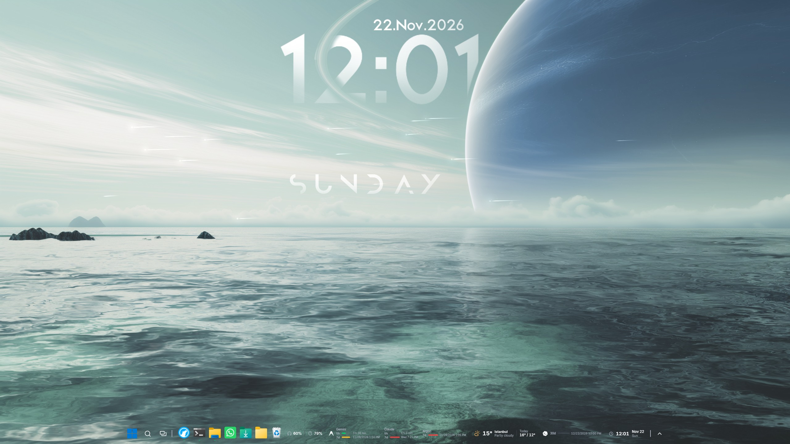
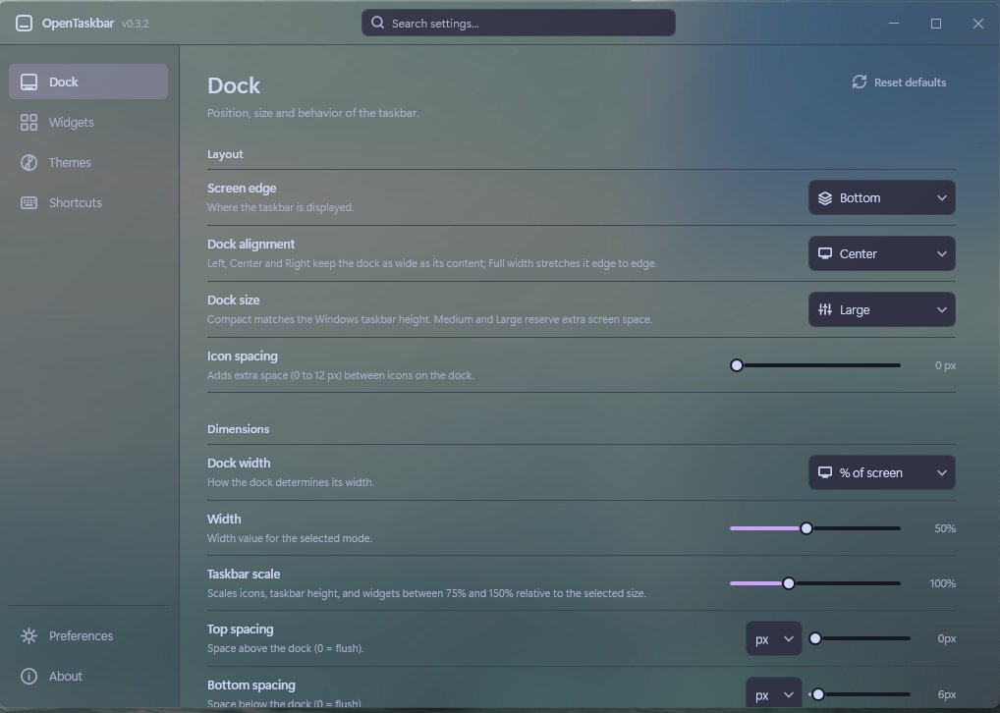
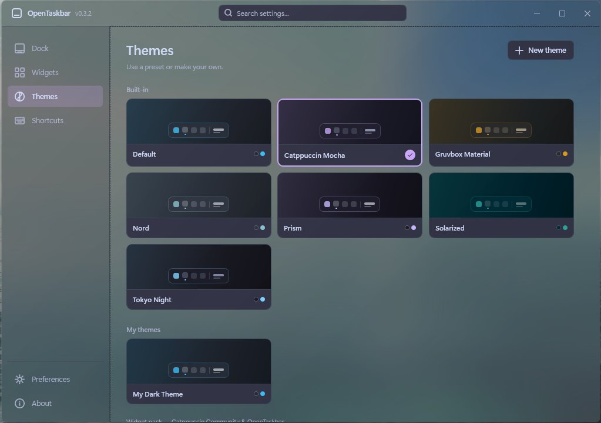

# OpenTaskbar

<div align="center">

**A dock for Windows, like the one on macOS.**

[](https://github.com/alztrk/opentaskbar)
[](https://github.com/alztrk/opentaskbar)
[](https://github.com/alztrk/opentaskbar)
[](LICENSE)
[](crates/opentaskbar-core/tests)




</div>

OpenTaskbar replaces the Windows taskbar with a floating row of app icons. Hover over an icon and it grows; click it and the app opens. It works on Windows 10 and 11, and you don't need to install anything or be an administrator to use it.

## What you can do with it

- **See what's open.** Hover over an app icon to see its open windows. Click a window to switch to it, or use the × on its preview to close it.
- **Keep your apps handy.** Drag an app onto the dock to pin it. Move icons around, put related apps in a group, or make a folder stack. Drag an icon off the dock to unpin it.
- **Reach Windows controls.** Start, Search, Task View and the Recycle Bin have their own buttons. Right-click an app to see its Windows Jump List (pinned tasks and recent files).
- **Hide it when you want.** Choose to keep it always visible, hide it when a window covers it, or hide it until you move your mouse to its edge. It also gets out of the way for fullscreen games and videos.
- **Make it look like yours.** Move it to the bottom, left or right of your screen; change its size, corners and see-through look; pick one of six color themes or add your own. You can even change the app icons — see [Themes](docs/guides/themes.md).
- **See useful things at a glance.** 22 widgets are included. Examples: clock & date, weather, day progress, stopwatch, countdown, system stats, net speed, battery, Bluetooth battery, storage, focus, media and audio, Wi-Fi and Bluetooth switches, quick settings, keyboard layout, and AI quota widgets for Claude, Codex, OpenCode, Copilot, DeepSeek, OpenRouter and Cursor (plus an aggregate). You can also [add your own](docs/guides/custom-widgets.md).
- **Use every screen.** Have a dock on each monitor, or use the optional strip at the top of the screen.
- **Never lose your taskbar.** If OpenTaskbar closes or crashes, the normal Windows taskbar comes back by itself. You can also restore it any time with `OpenTaskbar.exe --restore`.

<div align="center">

| Dock settings | Themes |
| :---: | :--- |
|  |  |

</div>

## Mouse shortcuts

| Do this | It does |
| :--- | :--- |
| `Shift + mouse wheel` over the dock | Scroll sideways through icons |
| `Ctrl + mouse wheel` over the dock | Scroll sideways, more precisely |
| `Middle mouse button + drag` | Move through icons that don't fit |
| `Alt + F4` | Close a window preview |
| `Esc` | Close an open menu or popup |

## Get it running

1. Go to [GitHub Releases](https://github.com/alztrk/opentaskbar/releases) and download `OpenTaskbar-v0.3.5-win-x64.exe` (most PCs) or `OpenTaskbar-v0.3.5-win-x86.exe` (32-bit Windows).
2. Double-click the file. That's it — no installer, no extra software, no admin rights.

You need Windows 10 (version 2004 or newer) or Windows 11. The portable build checks for new versions itself. Releases also include a ZIP, checksums and release notes.

To change the language or the look, open **Settings → Appearance**. There are 14 languages; see [Languages](docs/guides/localization.md).

## Privacy and license

OpenTaskbar doesn't collect anything about you. The portable build checks for updates by default; turn that off in Settings if you don't want the check. Otherwise it only goes online when you turn on a feature that needs it, such as weather, and your credentials stay on your computer. See [PRIVACY.md](PRIVACY.md). It's free under the MIT license — see [LICENSE](LICENSE).

<details>
<summary><strong>Technical details (for developers)</strong></summary>

Version **0.3.5**. The repository root is a Cargo workspace; run all commands below from there.

### Build and check it

```powershell
git clone https://github.com/alztrk/opentaskbar.git
cd opentaskbar

cargo run --bin OpenTaskBar                 # start the dock
cargo run --bin OpenTaskBar -- --settings   # open Settings only

# Same gates as CI
cargo check --workspace
cargo fmt --all -- --check
cargo clippy --workspace --all-targets -- -D warnings
cargo test --workspace

powershell -ExecutionPolicy Bypass -File .\scripts\check-locale-parity.ps1
powershell -ExecutionPolicy Bypass -File .\scripts\check-release-version.ps1 -Tag v0.3.5
```

Building needs Rust 1.95+ (edition 2024, MSVC on Windows) and PowerShell 7+ for packaging. Generated build and package files are kept under `artifacts/`: Cargo intermediates in `artifacts/cargo/`, portable and versioned release files in `artifacts/release/`, and MSIX work and packages in `artifacts/msix-rust/`.

```powershell
# Portable EXE and verification
.\scripts\publish-portable.ps1 -Runtime win-x64
.\scripts\check-portable.ps1 -ExecutableName OpenTaskbar-x64.exe

# MSIX package (identity 0.3.5.0)
.\scripts\publish-rust-msix.ps1 -Runtime win-x64

# Versioned release artifacts
.\scripts\package-rust-release.ps1 -Tag v0.3.5
```

`publish-portable.ps1` builds one self-contained EXE per architecture with the matching watchdog embedded; `build.rs` validates the embedded watchdog's architecture. At runtime, the app materializes the watchdog in its shared app-data directory for crash recovery. `check-portable.ps1` verifies the EXE architecture and icon worker. The release script writes the x64/x86 EXEs and ZIPs, `checksums.txt`, a schemaVersion 3 `release-manifest.json` and `release-notes.md`.

Tests cover deterministic settings/i18n/shell-recovery logic; real Windows behavior needs the manual checks in [docs/development/windows-reliability-audit.md](docs/development/windows-reliability-audit.md). Design notes: [docs/development/windows-taskbar-model.md](docs/development/windows-taskbar-model.md).

### Command line

| Argument | Effect |
| :--- | :--- |
| *(none)* | Acquire the single-instance lock, repair a pending journal, load settings, run the dock |
| `--settings` | Open only the Settings window; exit when it closes |
| `--restore` | Replay the taskbar/flyout recovery journal and exit |
| `--extract-icons` | Icon extractor worker driven over stdin/stdout |
| `--software-render` | Force software rendering for this launch |
| `--update*` / `action=update*` | Update-toast activation arguments handled by the in-app updater |

There are no file-manager or panel launch modes.

### Where data is stored

Everything lives in `%LOCALAPPDATA%\OpenTaskbar\`:

| Path | Contents |
| :--- | :--- |
| `settings.json` | Preferences, dock geometry, pins, widget IDs, profiles |
| `opentaskbar.log` | Diagnostics; rotated to `opentaskbar.log.old` |
| `Themes\` | Installed theme packs |
| `secrets\` | DPAPI-protected provider credentials |
| `rust-cache\icon-cache\` | Extracted icons |
| `taskbar-state.txt`, `flyout-positions.txt` | Recovery journals |
| `OpenTaskbarWatchdog.exe` | Runtime watchdog extracted from the app EXE for crash recovery |

Unknown settings keys are preserved on save, invalid JSON is backed up before defaults are restored, and no secret is written to the log or to `.otbackup` archives. The old separate-folder layout is retired; import a full backup to migrate from it.

### Widget catalog

The catalog is generated from `crates/opentaskbar-app/src/widgets/registry.rs`: Time & Weather (Clock & Date, Weather, Day Progress, Stopwatch, Countdown), System & Hardware (System Stats, Net Speed, Battery, Bluetooth Battery, Storage), AI Quotas (seven providers plus an aggregate), Media & Controls (Media, Audio, Quick Settings, Keyboard Layout) and Productivity (Focus). Folder Stacks and App Groups are dock helpers; Show Desktop is a shell action. [Custom widgets](docs/guides/custom-widgets.md) run as separate local processes.

### Code layout

| Crate | Responsibility |
| :--- | :--- |
| `opentaskbar-core` | Settings schema, i18n (14 catalogs), paths, logging, deterministic logic |
| `opentaskbar-shell` | Taskbar journal, AppBar reservation, flyout repositioning, watchdog |
| `opentaskbar-app` | GPUI dock and Settings UI, widget catalog, Win32 platform layer |

Bundled resources live in `resources/fonts/`, `resources/assets/` and `resources/themes/`; the root also holds `packaging/msix/`, `scripts/`, `tests/reference/locales/` and `tools/watchdog/`. User guides are in `docs/guides/`, engineering notes in `docs/development/`. CI lives in `.github/workflows/`: `ci.yml` (fmt, clippy, tests, release build), `rust-ci.yml` (watchdog/x86 and locale gates) and `release.yml` (packaging with SLSA attestation and an optional VirusTotal scan).

### Feature flags

Flags are read from `DockSettings.extra`; defaults match the code.

| Flag | Default | Effect |
| :--- | :--- | :--- |
| `enable_live_tray_host` | `false` | Registry discovery and tray strip leave the native tray untouched |
| `native_flyout_reposition` | `true` | Generation-cancelled Start/Search/Control Center positioning; `false` uses journal-only legacy positioning |
| `enable_vertical_dock` | `true` | Left/right edges enabled; `false` forces Bottom |

The theme editor, vendor battery reading and AI sign-in flows are always
available; they are not gated by settings flags.

</details>
